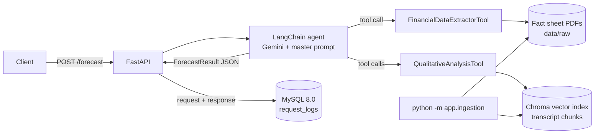

# TCS Financial Forecasting Agent

An AI agent, served through FastAPI, that reads **Tata Consultancy Services (TCS)** quarterly
financial reports and earnings-call transcripts and returns a **structured, qualitative
business-outlook forecast** for the next quarter. Every request and its JSON result are
logged to **MySQL 8.0**.

> **Current release: V1 (Foundation).** The pipeline runs end to end. V2 adds robust table
> extraction, hybrid retrieval and citations; V3 adds market data, evaluation and hardening.
> See [CHANGELOG.md](CHANGELOG.md).

---

## 1. Project overview

### What it does

`POST /forecast` takes an analytical task (for example *"Analyze the last three quarters and
forecast the next one"*). A LangChain tool-calling agent powered by **Google Gemini** then:

1. calls **FinancialDataExtractorTool** to get revenue, operating margin, net profit and EPS for
   every quarter in the fact sheets, plus QoQ and YoY growth,
2. calls **QualitativeAnalysisTool** several times (RAG over the earnings-call transcripts) for
   demand, margins, AI opportunities and risks,
3. cross-checks what management says against the numbers, and
4. returns a validated `ForecastResult` JSON object (trends, outlook, risks, opportunities,
   forecast, confidence, data gaps).

### Architecture



### Design choices

| Decision | Why |
|---|---|
| Two narrow tools instead of one big RAG | Numbers and narrative need different methods: exact table reading against semantic search. |
| Locate the income-statement page with rules, then let the LLM read only that page | Cheaper and more reliable than sending a 25-page PDF; margins are recomputed in Python, not trusted from the LLM. |
| Newest document wins when quarters overlap | Each fact sheet repeats earlier quarters; the latest one carries restated figures. |
| `ToolStrategy` structured output on a Pydantic schema | The final answer is a schema "tool call"; invalid output is returned to the model with the validation error so it retries. |
| Extraction results cached in `data/processed/` | Repeat requests skip re-parsing and save tokens. |
| Every request logged (success **and** failure) | Full audit trail; `GET /forecast/{request_id}` reads it back. |

### Data sources

Documents for the last three quarters (Q4 FY26, Q1 FY27, Q2 FY27) are listed in
[`data/manifest.json`](data/manifest.json), taken from the
[Screener.in documents section](https://www.screener.in/company/TCS/consolidated/#documents):

- **Financial reports:** TCS quarterly fact sheets (tcs.com). Each contains an *Ind AS Income Statement – Consolidated* table.
- **Earnings-call transcripts:** BSE filings.

TCS's fiscal year runs April–March: Q4 FY26 = Jan–Mar 2026, Q1 FY27 = Apr–Jun 2026,
Q2 FY27 = Jul–Sep 2026. The forecast target is **Q3 FY27 (Oct–Dec 2026)**.

---

## 2. Agent and tool design

### FinancialDataExtractorTool (`app/tools/financial_extractor.py`)

| Step | How |
|---|---|
| Read PDF | `pdfplumber` extracts text per page |
| Find the table | Pages are scored on keywords ("Ind AS", "Consolidated", "Income Statement", "Revenue", "Net Profit", "Earnings per share"); the best page is chosen |
| Extract | Gemini (temperature 0) fills an `ExtractedStatement` Pydantic schema with every quarter column on that page |
| Validate | Operating and net margins are recomputed from the extracted absolute values |
| Merge and trend | Results from all fact sheets are merged (newest wins); QoQ and YoY growth and margin change in bps are computed in Python |
| Output | JSON: `metrics`, `trends`, `sources` (document + page per quarter), `errors` |

### QualitativeAnalysisTool (`app/tools/qualitative_analysis.py`)

| Step | How |
|---|---|
| Index (offline) | Transcripts split into ~1,500-character chunks (200 overlap), tagged with quarter and page, embedded with `gemini-embedding-001`, stored in Chroma |
| Retrieve | Top 8 chunks by semantic similarity, optionally filtered to one quarter |
| Analyse | Gemini reads **only** the retrieved excerpts and fills `QualitativeInsights`: themes (with quarters), sentiment + rationale, forward-looking statements, risks, opportunities |
| Output | JSON with the insights plus the evidence excerpts (quarter, page) |

### The agent (`app/agent/`)

A LangChain v1 `create_agent` graph with Gemini, both tools, and `response_format=ToolStrategy(ForecastResult)`.

**Master prompt** (full text in [`app/agent/prompts.py`](app/agent/prompts.py)). In short, it:

- sets the role (senior equity analyst covering TCS) and explains TCS's fiscal calendar,
- asks for a **qualitative** forecast, with no exact numbers and no investment advice,
- prescribes the steps: **numbers → trends → narrative (at least 4 focused transcript
  queries: demand, margins, AI opportunities, risks) → cross-check → forecast**,
- enforces grounding rules: use only tool output, name a source for every risk and
  opportunity, copy quotes from the excerpts, and record gaps instead of guessing.

### Output schema (`app/schemas/forecast.py`)

```json
{
  "request_id": "6c1d...",
  "status": "success",
  "model": "gemini-3.6-flash",
  "generated_at": "2026-11-06T10:00:00Z",
  "latency_ms": 42000,
  "tool_calls": ["financial_data_extractor({})", "qualitative_analysis({'query': '...'})"],
  "result": {
    "company": "Tata Consultancy Services (TCS)",
    "forecast_period": "Q3 FY27",
    "quarters_analyzed": ["Q4 FY26", "Q1 FY27", "Q2 FY27"],
    "quarterly_metrics": [{"quarter": "Q2 FY27", "revenue_cr": 73188, "operating_margin_pct": 23.98, "net_profit_cr": 13884, "eps_inr": 38.37}],
    "financial_trends": [{"metric": "Revenue growth", "direction": "stable", "evidence": "..."}],
    "management_outlook": {"summary": "...", "sentiment": "cautiously_optimistic", "key_quotes": [{"text": "...", "quarter": "Q2 FY27"}]},
    "risks": [{"title": "...", "detail": "...", "source": "Q2 FY27 earnings call"}],
    "opportunities": [{"title": "...", "detail": "...", "source": "Q1 FY27 earnings call"}],
    "forecast": {"revenue_outlook": "...", "margin_outlook": "...", "overall_outlook": "...", "confidence": "medium"},
    "data_gaps": []
  }
}
```

---

## 3. Setup instructions (Windows, macOS, Linux)

### Prerequisites

| Requirement | Version | Check |
|---|---|---|
| Python | 3.10 – 3.12 recommended | `python --version` |
| Git | any | `git --version` |
| MySQL Server | 8.0 | `mysql --version` |
| Google Gemini API key | free tier works | [aistudio.google.com/apikey](https://aistudio.google.com/apikey) |

### Step 1: Clone and create a virtual environment

```bash
git clone https://github.com/LalithaSriHarshitha/Financial-Forecasting-Agent.git
cd Financial-Forecasting-Agent

python -m venv .venv
```

Activate the virtual environment. Use the line for your terminal:

| Terminal | Command |
|---|---|
| Windows Command Prompt (`C:\...>`) | `.venv\Scripts\activate.bat` |
| Windows PowerShell (`PS C:\...>`) | `.venv\Scripts\Activate.ps1` |
| macOS / Linux | `source .venv/bin/activate` |

Your prompt should now start with `(.venv)`. Then install:

```bash
pip install -r requirements.txt
```

> If PowerShell blocks the activate script, run once:
> `Set-ExecutionPolicy -Scope CurrentUser RemoteSigned`
>
> Type commands one per line, without trailing `# comments`; Command Prompt treats them as arguments.

### Step 2: Create the MySQL database and user

```bash
mysql -u root -p
```

```sql
CREATE DATABASE tcs_forecast CHARACTER SET utf8mb4 COLLATE utf8mb4_unicode_ci;
CREATE USER 'forecast_user'@'localhost' IDENTIFIED BY 'YourStrongPass@123';
GRANT ALL PRIVILEGES ON tcs_forecast.* TO 'forecast_user'@'localhost';
FLUSH PRIVILEGES;
EXIT;
```

The app creates its tables automatically on startup.

### Step 3: Configure credentials

```bash
# Windows:
copy .env.example .env
# macOS / Linux:
cp .env.example .env
```

Edit `.env`:

| Variable | Value |
|---|---|
| `GOOGLE_API_KEY` | your Gemini API key |
| `GEMINI_MODEL` | chat model id (default `gemini-3.6-flash`; `python -m app.check` lists the models your key can use) |
| `GEMINI_EMBEDDING_MODEL` | `models/gemini-embedding-001` |
| `MYSQL_HOST` / `MYSQL_PORT` | `localhost` / `3306` |
| `MYSQL_USER` / `MYSQL_PASSWORD` | the user from Step 2 |
| `MYSQL_DATABASE` | `tcs_forecast` |

### Step 4: Download the documents and build the RAG index

```bash
python -m app.ingestion
```

This downloads the six PDFs in `data/manifest.json` into `data/raw/` and indexes the
transcripts into `data/chroma/`. tcs.com sometimes blocks scripted downloads (HTTP 403). If it
does, the log prints the URL: open it in your browser, save the PDF into `data/raw/` with the
file name shown, and run:

```bash
python -m app.ingestion --skip-download
```

### Step 5: Verify the setup

```bash
python -m app.check
```

This checks the Gemini key and model, the MySQL connection and tables, the documents and the index.

---

## 4. How to run

```bash
uvicorn app.main:app --reload
```

- Interactive API docs: <http://127.0.0.1:8000/docs>
- Health check: <http://127.0.0.1:8000/health>

### Generate a forecast

PowerShell:

```powershell
Invoke-RestMethod -Method Post -Uri http://127.0.0.1:8000/forecast -ContentType "application/json" `
  -Body '{"task": "Analyze the financial reports and transcripts for the last three quarters and provide a qualitative forecast for the upcoming quarter. Identify key financial trends, summarize management outlook, and highlight significant risks and opportunities."}' | ConvertTo-Json -Depth 10
```

curl (macOS / Linux / Git Bash):

```bash
curl -X POST http://127.0.0.1:8000/forecast -H "Content-Type: application/json" \
  -d '{"task": "Analyze the financial reports and transcripts for the last three quarters and provide a qualitative forecast for the upcoming quarter."}'
```

Sending `{}` uses the example task from the assignment. A request takes about 30–90 seconds.

### Endpoints

| Method | Path | Purpose |
|---|---|---|
| `GET` | `/health` | DB status, documents found, index built |
| `POST` | `/forecast` | Run the agent; returns `ForecastResponse` JSON |
| `GET` | `/forecast/{request_id}` | Read a logged request and response back from MySQL |

### See the logs in MySQL

```sql
USE tcs_forecast;
SELECT request_id, status, latency_ms, created_at FROM request_logs ORDER BY id DESC LIMIT 10;
```

### Run the tests

```bash
pytest -q
```

The tests use SQLite and a scripted fake LLM, so they need neither MySQL nor a Gemini key. They
include a run of the real agent graph that chains both tools into the structured output.

---

## 5. Project structure

```text
app/
  main.py                  FastAPI app and endpoints
  config.py                settings from .env
  llm.py                   Gemini chat + embedding factories
  check.py                 setup verification (python -m app.check)
  agent/
    prompts.py             master prompt
    forecast_agent.py      LangChain agent + structured output
  tools/
    financial_extractor.py FinancialDataExtractorTool
    qualitative_analysis.py QualitativeAnalysisTool (RAG)
    quarters.py            fiscal-quarter helpers
  ingestion/               download, PDF parsing, chunking, Chroma index
  schemas/                 Pydantic models (tool outputs, API request/response)
  db/                      SQLAlchemy models, session, repository
data/manifest.json         document list with source URLs
tests/                     pytest suite
```

---

## 6. Troubleshooting

| Problem | Fix |
|---|---|
| `Can't connect to MySQL server` | Start the service (`net start MySQL80` in an admin PowerShell) and check the `MYSQL_*` values |
| `cryptography package is required` | `pip install cryptography` (already in requirements) |
| `model ... not found` | Run `python -m app.check` and set `GEMINI_MODEL` to a listed model |
| `429` / quota errors from Gemini | The app already paces itself (`LLM_REQUESTS_PER_MINUTE`, `EMBED_REQUESTS_PER_MINUTE` in `.env`) and retries. If you still hit limits, lower those values; a daily quota resets the next day |
| `No transcript excerpts found` | Run `python -m app.ingestion` |
| Download blocked (`response is not a PDF`) | Save the PDF manually into `data/raw/` (see Step 4) |

AI usage notes are in [AI_USAGE.md](AI_USAGE.md). They will be completed in V3.
