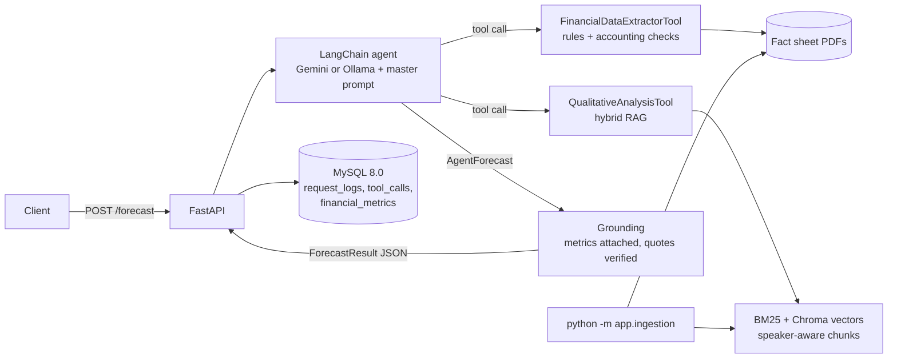

# TCS Financial Forecasting Agent

An AI agent, served through FastAPI, that reads **Tata Consultancy Services (TCS)** quarterly
financial reports and earnings-call transcripts and returns a **structured, qualitative
business-outlook forecast** for the next quarter. It runs on **Google Gemini** or on **local
models via Ollama**, selected with one setting. Every request, every tool call and the final
JSON are logged to **MySQL 8.0**.

> **Current release: V2 (Intelligence).** Rules-first financial extraction validated by
> accounting identities (100% accuracy on the ground-truth set), speaker-aware hybrid RAG, and
> grounding checks that remove unsupported quotes. V3 adds market data, evaluation and hardening.
> See [CHANGELOG.md](CHANGELOG.md).

---

## 1. Project overview

### What it does

`POST /forecast` takes an analytical task (for example *"Analyze the last three quarters and
forecast the next one"*). A LangChain tool-calling agent then:

1. **gathers** in one turn, calling both tools in parallel:
   - **FinancialDataExtractorTool**: validated revenue, employee cost, operating margin, net
     profit, EPS, USD and constant-currency growth, order-book TCV, headcount and attrition for
     every quarter, with QoQ/YoY trends;
   - **QualitativeAnalysisTool**: themes, sentiment and verified management statements from the
     earnings calls, on demand, margins, AI opportunities and risks;
2. **analyses** trends over the last three quarters, optionally with one targeted follow-up search;
3. **cross-checks** what management says against the numbers;
4. **forecasts** the direction of revenue and margin, the risks, the opportunities and a
   confidence level.

Code then **grounds** the answer:
- The per-quarter numbers are attached from the validated extractor. The LLM never writes them.
- Every quote is checked against the transcripts; unsupported ones are removed.
- The forecast period is checked against the data.

### Architecture



### Design choices

| Decision | Why |
|---|---|
| Two narrow tools instead of one big RAG | Numbers need exact table reading; narrative needs search. Different jobs, different methods. |
| **Rules first, LLM only as fallback** for financial figures | In V1 the LLM misread Q4 FY26 (revenue 70,694 instead of 70,698; net profit 13,702 instead of 13,718) from garbled PDF text. A regex parser plus 7 accounting identities per quarter is exact, free and checkable. |
| PyMuPDF for PDF text | The fact sheets draw a phantom space over the first digit of each number ("6 5,799" in pdfplumber), and one draws its table as rotated text. PyMuPDF reads both correctly. |
| Newest document wins when quarters overlap | Each fact sheet repeats earlier quarters; disagreements are reported as restatements. |
| Speaker-aware chunks; Q&A answers carry their question | Retrieval can filter by management or analyst, and every excerpt says who spoke and when. |
| Hybrid retrieval (BM25 + vectors, reciprocal rank fusion) | Keywords catch names and terms ("MHP", "furlough", "TCV"); vectors catch paraphrases. |
| Retrieval per quarter | Every call is represented, so the tone can be compared across quarters. |
| Batched topics: about 4 LLM calls per forecast | Fits free-tier quotas and keeps latency around 1–2 minutes on Gemini. |
| Agent writes `AgentForecast`; code adds the numbers | Removes the main hallucination surface for figures. |
| Every request, tool call and metric stored in MySQL | Full audit trail; `GET /forecast/{request_id}` returns the request, response and tool trace. |

### Data sources

Documents for the last three quarters (Q4 FY26, Q1 FY27, Q2 FY27) are listed in
[`data/manifest.json`](data/manifest.json), taken from the
[Screener.in documents section](https://www.screener.in/company/TCS/consolidated/#documents):

- **Financial reports:** TCS quarterly fact sheets (tcs.com). Each has an *Ind AS Income
  Statement – Consolidated* table (3 quarters) and a *Performance Highlights* page. Together they
  give 7 quarters of history, Q4 FY25 to Q2 FY27.
- **Earnings-call transcripts:** BSE filings, 81–101 speaker turns each.

TCS's fiscal year runs April–March: Q4 FY26 = Jan–Mar 2026, Q1 FY27 = Apr–Jun 2026,
Q2 FY27 = Jul–Sep 2026. The forecast target is **Q3 FY27 (Oct–Dec 2026)**.

---

## 2. Agent and tool design

### FinancialDataExtractorTool (`app/tools/financial_extractor.py`, `factsheet_parser.py`)

| Step | How |
|---|---|
| Read PDF | PyMuPDF, layout-sorted text, Unicode-normalised |
| Find pages | The quarterly *Ind AS Income Statement – Consolidated* page (the annual one is skipped) and the *Performance Highlights* page |
| Parse | Regex per line item: revenue, employee cost, total expenditure, operating income, other income, PBT, tax, PAT, non-controlling interests, net profit, EPS, plus the % of revenue columns. Highlights: USD revenue, USD/CC growth (handles "up", "down" and "Flat"), TCV, headcount, attrition, cash conversion |
| **Validate** | 7 checks per quarter: cost lines sum to total; revenue − costs = operating income; operating income + other income = PBT; PBT − tax = PAT; PAT − NCI = net profit; the operating margin matches the published %; required fields are present |
| Fallback | If parsing or any check fails, the LLM reads that page; the result is flagged `verified: false` |
| Merge and trend | Newest document wins; restatements are reported. QoQ/YoY growth for revenue and net profit; margin and employee-cost change in bps; headcount change |
| Store | Cached per file version in `data/processed/`; upserted into MySQL `financial_metrics` |
| Output | JSON with `metrics`, `trends`, `validation` (checks passed, method per document, restatements) and `errors` |

**Accuracy:** `python -m eval.extraction` compares 33 values (11 fields × 3 quarters) with
[`eval/ground_truth.json`](eval/ground_truth.json), typed from the fact sheets: **33/33 = 100%**,
with no LLM calls.

### QualitativeAnalysisTool (`app/tools/qualitative_analysis.py`, `ingestion/transcripts.py`)

| Step | How |
|---|---|
| Parse (offline) | Each transcript is split into speaker turns, skipping the cover letter and page footers. Each turn is tagged with **role**: management, analyst (people the moderator introduces) or moderator. It also gets a **section** (prepared remarks or Q&A) and the **page** |
| Chunk | ~1,200 characters within a turn, prefixed `[Speaker (role, section)]`. Q&A answers are prefixed with the analyst question they answer |
| Index | Embeddings (`gemini-embedding-001` or `nomic-embed-text`) in Chroma, one index per embedding model; BM25 keyword index built from the same chunks |
| Retrieve | All topics in one call. For each topic and each quarter, BM25 and vector results are fused with reciprocal rank fusion. Optional `speaker_role` and `quarter` filters |
| Analyse | One LLM call over the excerpts produces `QualitativeInsights`: themes with quarters, sentiment and how it changed, word-for-word management statements, risks, opportunities |
| **Ground** | Each statement must match an excerpt (at least 80% word coverage). Unsupported ones are removed; quarter and speaker are corrected from the source chunk |
| Output | JSON with the insights, a grounding summary and evidence excerpts (quarter, page, speaker, role) |

### The agent (`app/agent/`)

A LangChain v1 `create_agent` graph with the configured chat model, both tools, and
`response_format=ToolStrategy(AgentForecast)`. Invalid output is returned to the model with the
validation error so it retries. A callback handler logs each LLM and tool call live and records
the tool calls for MySQL.

**Master prompt** (full text in [`app/agent/prompts.py`](app/agent/prompts.py)) sets the role
(senior equity analyst covering TCS) and the fiscal calendar, then prescribes the steps:

1. **Gather** with both tools in parallel (4 standard transcript topics).
2. **Trends** over the last 3 quarters: CC growth, margin drivers, TCV, headcount, attrition.
3. **At most one follow-up** search.
4. **Cross-check** management's statements against the numbers.
5. **Forecast** the direction of revenue and margin, with a confidence level.

Its grounding rules: use only tool output; copy quotes word for word from verified statements;
name a source (quarter, and speaker or fact sheet) for every risk and opportunity; record gaps
instead of guessing; and do not restate the per-quarter numbers, because code attaches them.

**Post-processing** (`forecast_agent.py`):
- Attaches validated `quarterly_metrics` for the analysed quarters.
- Corrects `forecast_period` if it isn't the quarter after the latest one.
- Verifies every key quote against all transcript chunks.
- Reports all of this in `grounding`.

### Output schema (`app/schemas/forecast.py`)

```json
{
  "request_id": "6c1d...",
  "status": "success",
  "model": "gemini-3.6-flash",
  "generated_at": "2026-11-06T10:00:00Z",
  "latency_ms": 95000,
  "tool_calls": ["financial_data_extractor({})", "qualitative_analysis({'queries': [...]})"],
  "grounding": {"accounting_checks": "63/63 passed", "quarters_verified": 3, "quotes_verified": 4, "quotes_removed_as_unsupported": []},
  "result": {
    "company": "Tata Consultancy Services (TCS)",
    "forecast_period": "Q3 FY27",
    "quarters_analyzed": ["Q4 FY26", "Q1 FY27", "Q2 FY27"],
    "quarterly_metrics": [{"quarter": "Q2 FY27", "revenue_cr": 73188, "revenue_growth_qoq_pct": 1.26, "revenue_growth_yoy_pct": 11.23, "cc_growth_qoq_pct": 0.5, "operating_margin_pct": 23.98, "employee_cost_pct": 57.24, "net_profit_cr": 13884, "net_margin_pct": 18.97, "eps_inr": 38.37, "order_book_tcv_usd_bn": 9.6, "headcount": 598056, "attrition_ltm_pct": 13.3, "verified": true, "source": "TCS Q2 FY27 Fact Sheet (quarterly financial results), page 21"}],
    "financial_trends": [{"metric": "Operating margin", "direction": "declining", "evidence": "..."}],
    "management_outlook": {"summary": "...", "sentiment": "cautiously_optimistic", "key_quotes": [{"text": "...", "quarter": "Q2 FY27", "speaker": "Samir Seksaria"}]},
    "risks": [{"title": "...", "detail": "...", "source": "Q2 FY27 earnings call, Samir Seksaria"}],
    "opportunities": [{"title": "...", "detail": "...", "source": "Q1 FY27 earnings call, K Krithivasan"}],
    "forecast": {"revenue_outlook": "...", "margin_outlook": "...", "overall_outlook": "...", "confidence": "medium"},
    "data_gaps": []
  }
}
```

---

## 3. Setup instructions (Windows, macOS, Linux)

### Prerequisites

| Requirement | Version | Check |
|---|---|---|
| Python | 3.10 – 3.12 recommended | `python --version` |
| Git | any | `git --version` |
| MySQL Server | 8.0 | `mysql --version` |
| **Ollama** (default provider) | latest; 16 GB RAM recommended (8 GB works with `qwen3:4b`) | [ollama.com/download](https://ollama.com/download), then `ollama --version` |
| *or* Google Gemini API key | only if `LLM_PROVIDER=gemini` | [aistudio.google.com/apikey](https://aistudio.google.com/apikey) |

### Step 1: Clone and create a virtual environment

```bash
git clone https://github.com/LalithaSriHarshitha/Financial-Forecasting-Agent.git
cd Financial-Forecasting-Agent

python -m venv .venv
```

Activate the virtual environment. Use the line for your terminal:

| Terminal | Command |
|---|---|
| Windows Command Prompt (`C:\...>`) | `.venv\Scripts\activate.bat` |
| Windows PowerShell (`PS C:\...>`) | `.venv\Scripts\Activate.ps1` |
| macOS / Linux | `source .venv/bin/activate` |

Your prompt should now start with `(.venv)`. Then install:

```bash
pip install -r requirements.txt
```

> If PowerShell blocks the activate script, run once:
> `Set-ExecutionPolicy -Scope CurrentUser RemoteSigned`
>
> Type commands one per line, without trailing `# comments`; Command Prompt treats them as arguments.

### Step 2: MySQL user (the database is created automatically)

On startup the app runs `CREATE DATABASE IF NOT EXISTS`, so with `root` you can skip this step.
To use a dedicated user instead (recommended), run:

```bash
mysql -u root -p
```

```sql
CREATE DATABASE tcs_forecast CHARACTER SET utf8mb4 COLLATE utf8mb4_unicode_ci;
CREATE USER 'forecast_user'@'localhost' IDENTIFIED BY 'YourStrongPass@123';
GRANT ALL PRIVILEGES ON tcs_forecast.* TO 'forecast_user'@'localhost';
FLUSH PRIVILEGES;
EXIT;
```

The app creates its tables automatically on startup.

### Step 2b: Install Ollama and pull the models (default provider)

Install Ollama from <https://ollama.com/download> and make sure the app is running. Then:

```bash
ollama pull qwen3:8b
ollama pull nomic-embed-text
```

`qwen3:8b` (about 5 GB) is the chat model with tool calling; `nomic-embed-text` (about 270 MB)
creates the transcript embeddings. On an 8 GB RAM machine use `qwen3:4b` and set
`OLLAMA_MODEL=qwen3:4b` in `.env`. Skip this step if you use Gemini.

### Step 3: Configure credentials

```bash
# Windows:
copy .env.example .env
# macOS / Linux:
cp .env.example .env
```

Edit `.env`:

| Variable | Value |
|---|---|
| `LLM_PROVIDER` | `ollama` (default) or `gemini` |
| `OLLAMA_MODEL` / `OLLAMA_EMBEDDING_MODEL` | `qwen3:8b` / `nomic-embed-text` (the models pulled in Step 2b) |
| `OLLAMA_NUM_CTX` | context window, default `16384` |
| `GOOGLE_API_KEY` | only for Gemini |
| `GEMINI_MODEL` | only for Gemini; `python -m app.check` lists the models your key can use |
| `MYSQL_HOST` / `MYSQL_PORT` | `localhost` / `3306` |
| `MYSQL_USER` / `MYSQL_PASSWORD` | the user from Step 2 |
| `MYSQL_DATABASE` | `tcs_forecast` |

### Step 4: Download the documents and build the RAG index

```bash
python -m app.ingestion
```

This downloads the six PDFs in `data/manifest.json` into `data/raw/` and indexes the
transcripts into `data/chroma/`. tcs.com sometimes blocks scripted downloads (HTTP 403). If it
does, the log prints the URL: open it in your browser, save the PDF into `data/raw/` with the
file name shown, and run:

```bash
python -m app.ingestion --skip-download
```

### Step 5: Verify the setup

```bash
python -m app.check
```

This checks the LLM provider (Ollama running and models pulled, or the Gemini key and model),
the MySQL connection and tables, the documents and the index.

Each embedding model gets its own index folder under `data/chroma/`, so after switching
`LLM_PROVIDER` run `python -m app.ingestion --skip-download` once to build the index for the new provider.

---

## 4. How to run

### Quick end-to-end run (one command)

```bash
python -m app.demo
```

This creates the database if needed, sends the assignment's example task to the real
`POST /forecast` endpoint, confirms the MySQL log row, prints a summary and saves the full JSON
to `sample_output.json`.

### Start the API service

```bash
uvicorn app.main:app --reload
```

- Interactive API docs: <http://127.0.0.1:8000/docs>
- Health check: <http://127.0.0.1:8000/health>

### Generate a forecast

PowerShell:

```powershell
Invoke-RestMethod -Method Post -Uri http://127.0.0.1:8000/forecast -ContentType "application/json" `
  -Body '{"task": "Analyze the financial reports and transcripts for the last three quarters and provide a qualitative forecast for the upcoming quarter. Identify key financial trends, summarize management outlook, and highlight significant risks and opportunities."}' | ConvertTo-Json -Depth 10
```

curl (macOS / Linux / Git Bash):

```bash
curl -X POST http://127.0.0.1:8000/forecast -H "Content-Type: application/json" \
  -d '{"task": "Analyze the financial reports and transcripts for the last three quarters and provide a qualitative forecast for the upcoming quarter."}'
```

Sending `{}` uses the example task from the assignment. A request takes about 30–90 seconds.

### Endpoints

| Method | Path | Purpose |
|---|---|---|
| `GET` | `/health` | DB status, documents found, index built |
| `POST` | `/forecast` | Run the agent; returns `ForecastResponse` JSON |
| `GET` | `/forecast/{request_id}` | Read a logged request, its response and its tool-call trace back from MySQL |
| `GET` | `/metrics?quarter=Q2 FY27` | Validated financial metrics, trends and the accounting-check summary (no LLM call) |

### See the logs in MySQL

```sql
USE tcs_forecast;
SELECT request_id, status, latency_ms, created_at FROM request_logs ORDER BY id DESC LIMIT 10;
SELECT request_id, sequence, tool_name, duration_ms, error FROM tool_calls ORDER BY id DESC LIMIT 10;
SELECT quarter, revenue_cr, operating_margin_pct, net_profit_cr, verified, extraction_method FROM financial_metrics ORDER BY quarter;
```

### Check extraction accuracy

```bash
python -m eval.extraction
```

This compares every extracted value with `eval/ground_truth.json` and prints a per-field report
(currently 33/33).

### Run the tests

```bash
pytest -q
```

The tests use SQLite and a scripted fake LLM, so they need neither MySQL nor an LLM. They
include a run of the real agent graph that chains both tools into the structured output.

---

## 5. Project structure

```text
app/
  main.py                    FastAPI app and endpoints
  config.py                  settings from .env (provider switch, paths, limits)
  llm.py                     chat model + embeddings factory (Gemini or Ollama)
  check.py                   setup verification       (python -m app.check)
  demo.py                    one-command end-to-end run (python -m app.demo)
  agent/
    prompts.py               master prompt
    forecast_agent.py        LangChain agent, structured output, grounding post-processing
    progress.py              live progress logging + tool-call recording
  tools/
    financial_extractor.py   FinancialDataExtractorTool (rules first, LLM fallback, merge, trends)
    factsheet_parser.py      regex parsers + accounting-identity validation
    qualitative_analysis.py  QualitativeAnalysisTool (hybrid RAG, statement grounding)
    grounding.py             quote verification against transcript chunks
    quarters.py              fiscal-quarter helpers
  ingestion/
    pdf.py                   PyMuPDF text extraction
    transcripts.py           speaker turns, roles, sections, chunking
    index.py                 Chroma index, BM25 + vector hybrid retriever
    fetch.py, manifest.py    document download and manifest
  schemas/                   Pydantic models (tool outputs, API request/response)
  db/                        SQLAlchemy models (request_logs, tool_calls, financial_metrics)
data/manifest.json           document list with source URLs
eval/                        ground truth + extraction accuracy script
tests/                       pytest suite (+ real fact-sheet page text in tests/fixtures)
```

---

## 6. Troubleshooting

| Problem | Fix |
|---|---|
| `Can't connect to MySQL server` | Start the service (`net start MySQL80` in an admin PowerShell) and check the `MYSQL_*` values |
| `cryptography package is required` | `pip install cryptography` (already in requirements) |
| `model ... not found` | Run `python -m app.check` and set `GEMINI_MODEL` to a listed model |
| `429` quota errors (per minute) | The app already paces itself (`LLM_REQUESTS_PER_MINUTE`, `EMBED_REQUESTS_PER_MINUTE` in `.env`) and retries. If you still hit limits, lower those values; a daily quota resets the next day |
| `429` with "quota exhausted" (per day) | Free-tier keys allow a limited number of requests per model per day (it can be as low as 20); quotas reset at midnight Pacific time. A forecast uses about 4–5 requests. Set `GEMINI_TOOL_MODEL` to a second model (e.g. a flash-lite model) to spread the load, or enable billing |
| `No transcript excerpts found` | Run `python -m app.ingestion` |
| Download blocked (`response is not a PDF`) | Save the PDF manually into `data/raw/` (see Step 4) |

AI usage notes are in [AI_USAGE.md](AI_USAGE.md). They will be completed in V3.
